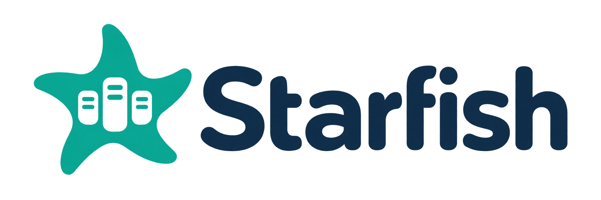
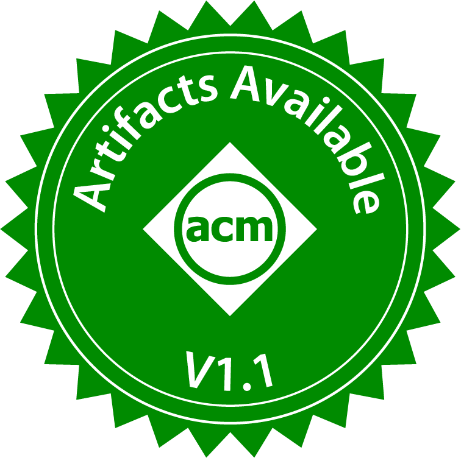
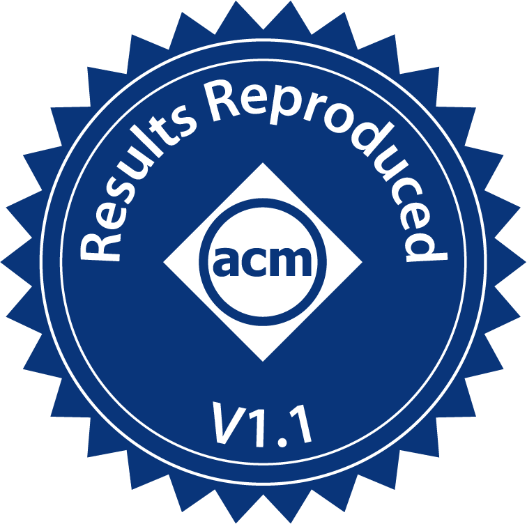

<p align="center">
  
</p>

<h2 align="center">
  A High-Performance Far-Memory Runtime with Optional Fault Tolerance
</h2>

<p align="center">
  <a href="#quick-start"><strong>Quickstart</strong></a> |
  <a href="docs/DEPLOYMENT.md"><strong>Documentation</strong></a> |
  <a href="#benchmarks"><strong>Benchmarks</strong></a> |
  <a href="#roadmap"><strong>Roadmap</strong></a> |
  <a href="docs/starfish-atc-2026.pdf"><strong>Paper</strong></a> |
  <a href="https://doi.org/10.1145/3828523.3857010"><strong>DOI</strong></a>
</p>

<p align="center">
  <a href="https://sysartifacts.github.io/atc2026/results"></a>
  <a href="https://sysartifacts.github.io/atc2026/results"></a>
  <a href="https://sysartifacts.github.io/atc2026/results"></a>
</p>

<p align="center">
  <sub>Available · Functional · Reproduced — awarded to the ATC 2026 paper artifact</sub>
</p>

## About

Starfish aims to deliver state-of-the-art far-memory performance, with or without
fault tolerance. Performance with fault tolerance disabled is a first-class goal.
Our current implementation uses RDMA, with CXL and other memory interconnects on
the roadmap.

<details>
<summary><strong>Repository scope</strong></summary>

We plan to keep developing and maintaining this standalone repository over the
long term. It contains the Starfish runtime, its memory server, existing runtime
tests, application source code under `apps/`, and the pinned libfibre source
with its errnoname dependency under `third_party/`. One normal clone includes
these sources; no recursive clone is needed. It does not bundle the paper's
separate Non-FT, Hydra-like, or Carbink-like baseline trees, input datasets, model
weights, or paper-level experiment scripts.

</details>

## Quick start

Install the system prerequisites listed below, then build from one normal clone:

```bash
git clone https://github.com/SSK015/Starfish.git
cd Starfish
bash scripts/build.sh
```

This configures and builds the runtime, memory server, and all application targets
in the table below. It builds the bundled libfibre automatically; no recursive
clone, separate libfibre checkout, or AE checkout is needed. Generated files stay
under `build/`, and the build log is `build/build.log`. The script does not install
system packages, download datasets, start memory servers, or run experiments.

<details>
<summary><strong>Build prerequisites</strong></summary>

Install the prerequisites first: Linux, Git, Bash, Python 3, CMake 3.16 or newer,
GNU Make or Ninja, a C++20 compiler with `std::format` support (e.g., GCC 13),
Boost program_options,
libibverbs development files, and ISA-L development files. Building the applications
also requires the HdrHistogram CMake package and OpenSSL. PAPI is optional.

</details>

<details>
<summary><strong>Build options and resource limits</strong></summary>

```bash
# Runtime libraries and memory server only; no HdrHistogram/OpenSSL dependency.
bash scripts/build.sh --runtime-only

# Selected targets, with explicit build parallelism.
bash scripts/build.sh --targets server,mg --jobs 2

# Inspect the configure/build commands without building.
bash scripts/build.sh --dry-run
```

The default is two parallel jobs. The launcher also enforces a quota of two CPUs
and an aggregate memory limit of 8 GiB for the whole build process tree, not just
each compiler process. It verifies existing cgroup limits or creates a temporary
systemd unit. Modern cgroup v2 systems need a working user systemd manager with
delegated CPU/memory controllers. Legacy cgroup v1 systems need an
administrator-provided limited scope or existing passwordless permission to run
`systemd-run` via `sudo -n`; the compiler still runs as the invoking user. If limits
cannot be enforced, the build stops before CMake. Swap is disabled for the unit
where supported; unsupported swap control is reported in the log.

Set `BUILD_CPUS`, `BUILD_MEMORY_GIB`, and `--jobs` to change these budgets.
Use `--build-dir DIR` for a separate build tree. A fresh build prefers Ninja and
GCC 13 when available; `CC` and `CXX` override the compiler choice. An existing
CMake cache retains its compiler and generator, so use a new build directory to
change them. Nonstandard dependencies can be selected with `BOOST_ROOT`,
`BOOST_LIBRARYDIR`, `HDR_HISTOGRAM_PREFIX`, or CMake options after `--`:

```bash
bash scripts/build.sh --build-dir build-custom --targets server,mg -- \
  -DCMAKE_PREFIX_PATH=/path/to/dependencies
```

PAPI is disabled by default, as in the AE build script; opt in with
`--enable-papi`. To use custom, prebuilt libfibre, pass
`-DLIBFIBRE_DIR=/absolute/path/to/libfibre` after `--`. The old environment
variable alone does not select an external checkout. See
`bash scripts/build.sh --help` for all options.

</details>

## Applications

| Source directory | Executable targets |
| --- | --- |
| `apps/llama/` | `run_chat_far` |
| `apps/bfs/` | `gapbs_bfs_chunked` |
| `apps/mg/` | `mg` |
| `apps/wordcount/` | `wordcount_far`, `wordcount_native`, `word_length_stats` |
| `apps/nq/` | `nhop_graph` |
| `apps/kvs/` | `kvs_throughput` |
| `apps/bandwidth_microbenchmark/` | `bandwidth_microbenchmark`, `bandwidth_microbenchmark_512` |

LLaMA and BFS are included whenever application builds are enabled. The other
application options are enabled automatically by the script for the selected
targets. An external application source tree can still be selected with
`-DFARLIB_APPS_DIR=/absolute/path/to/apps` after `--`.

Input graphs, text datasets, model weights, and generated correctness fixtures
are not bundled. Wordcount's fixture generator remains in
`apps/wordcount/testdata/generate_small_oracle.py`.
For workload inputs, site configuration, and full paper experiments, use the
original AE repository. Building these targets does not run experiments.

Existing runtime tests are available with `-DFARLIB_BUILD_TESTS=ON`; some tests
require RDMA hardware, separate physical servers, and a valid site configuration.

## Hardware and deployment

Running Starfish needs **at least two physical Linux x86-64 machines connected
by InfiniBand**: one compute machine and one memory machine. The memory machine
may run several memory-server processes on different ports. Multiple physical
memory machines are supported too.

Multiple processes on one memory machine are logical endpoints, not independent
physical failure domains. For hardware requirements, endpoint configuration, and
physical-failure testing boundaries, see the
[deployment guide](docs/DEPLOYMENT.md).

## Benchmarks

The [paper](docs/starfish-atc-2026.pdf) reports Starfish's fault-tolerant evaluation.
For the complete baselines, workload inputs, site configuration, and reproduction
workflow, use the preserved [ATC 2026 artifact](https://github.com/ICTPLSys/Starfish).
This maintained repository includes the application and microbenchmark sources
under [`apps/`](apps/).

## Roadmap

- **Runtime performance:** Continue optimizing with fault tolerance both disabled
  and enabled.
- **Memory interconnects:** Extend beyond the current RDMA implementation to CXL
  and other memory interconnects.
- **Developer experience:** Improve application integration, testing, and
  reproducible benchmarking.

### Contributing

Contributions to runtime performance, new backends, application integrations,
and reproducible benchmarks are welcome. Use
[GitHub Issues](https://github.com/SSK015/Starfish/issues) to report problems or
discuss ideas.

## Paper and artifact

**Starfish: Fault-Tolerant Far Memory with Low Resource and Performance Overhead**
(SIGOPS ATC 2026).

By Yanwen Xia, Benyong Deng, Hong Huang, Yuzheng Wang, Quanxi Li, Xingda Wei,
Xiaobing Feng, Huimin Cui, and Chenxi Wang.

[Paper (PDF)](docs/starfish-atc-2026.pdf) ·
[DOI](https://doi.org/10.1145/3828523.3857010) ·
[Artifact](https://github.com/ICTPLSys/Starfish) ·
[AE results](https://sysartifacts.github.io/atc2026/results)

The ATC 2026 paper artifact received **Available, Functional, and Reproduced** badges.
The [official AE results](https://sysartifacts.github.io/atc2026/results) apply to
that complete artifact, not to a separate evaluation of this maintained repository.

## Source and license

The initial runtime source is extracted from
[ICTPLSys/Starfish at bb028eef7878c2abc90c32c7353e58a8b5ade562](https://github.com/ICTPLSys/Starfish/tree/bb028eef7878c2abc90c32c7353e58a8b5ade562/artifact-evaluation/runtime/starfish),
plus the four headers from `artifact-evaluation/runtime/common/`. Application
sources come from `artifact-evaluation/apps/` at that same revision, excluding
generated fixtures and the unused chat input file. Include paths, standalone build
configuration, and documentation are adapted for this layout; the application
algorithms and the original AE source tree are unchanged.

Starfish source uses [Apache-2.0](LICENSE). Third-party notices are retained,
including the [MIT license for the LLaMA inference code](apps/llama/LICENSE)
and the NAS Parallel Benchmarks notices in `apps/mg/`. Bundled libfibre retains
its GPL license, and errnoname retains its separate license; see
[third-party sources and licenses](third_party/README.md). External dependencies
retain their own licenses. No dependency binaries are bundled here.
